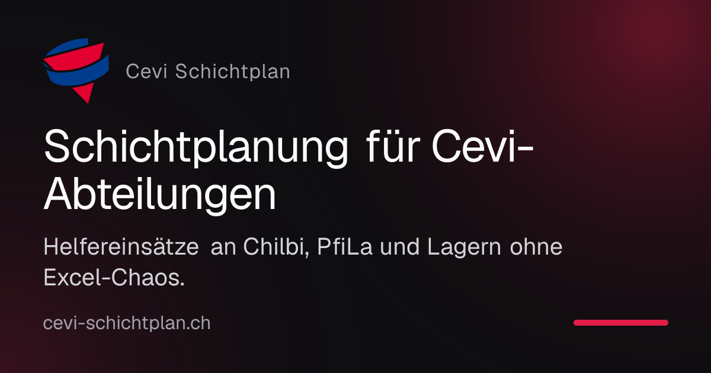
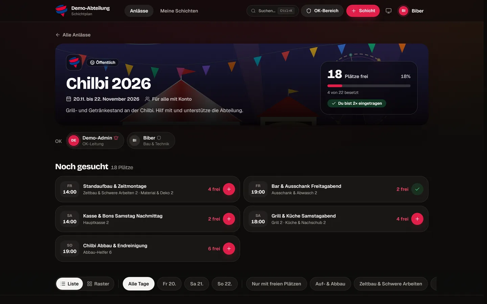

**Bereit zum Einsatz** – Schluss mit unübersichtlichen Excel-Tabellen, Versionskonflikten und mühsamen Helfer-Einteilungen. Der **Cevi Schichtplan** ist eine moderne, massgeschneiderte Web-Plattform zur Organisation von Schichtplänen, Einsätzen und Helferteams für Cevi-Abteilungen in der Schweiz.

Auf [cevi-schichtplan.ch](https://cevi-schichtplan.ch) kannst du den Schichtplan direkt für deine Abteilung und eure nächsten Anlässe einsetzen.

 

## ✨ Hauptfunktionen

* 🏰 **Eigene Abteilungs-Präsenz (Multi-Tenant):** Jede Abteilung erhält eine eigene Subdomain (z. B. `https://<abteilung>.cevi-schichtplan.ch`) mit individueller Farbgebung, eigenem Logo und passenden Stufen.
* 🔑 **Cevi.DB (Hitobito) Single Sign-On:** Nahtlose OAuth-2.0-Integration mit der zentralen Verbandsdatenbank `db.cevi.ch`. Automatische Synchronisation von Cevi-Namen, Geburtsdaten und Leitungsrechten.
* ⛺ **Multi-Event-Architektur:** Parallele Organisation beliebig vieler Anlässe pro Abteilung (z. B. Chilbi, Pfingstlager, Sommerlager, Suppentag oder Sponsorenlauf).
* 🛠️ **Mächtiger OK-Bereich:**
  * Schichten-Seriengenerator für wiederkehrende Zeitblöcke.
  * Aufgabenkatalog mit Jugendschutz-Regeln (Mindestalter, J+S-Leitungsanforderungen).
  * Helfer-Pool und Soll-Roster zur Überwachung der Schichtabdeckung.
  * Granulares Rollen- und Rechtesystem.
  * PDF-Druckexport im professionellen Cevi-Design sowie CSV/Excel-Export.
* 🙋 **Intuitive Helfer*innen-Experience:**
  * 1-Klick-Schichtanmeldung oder unkomplizierte Gast-Eintragung.
  * **«Ersatz gesucht»:** Helfer*innen können Schichten bei Verhinderung ausschreiben und direkt weitergeben.
  * **PWA & Offline-Briefing:** Schichtdetails, Standorte, Notfallkontakte und Check-in-QR-Code bleiben auch bei schwachem Empfang auf dem Festgelände offline verfügbar.
  * **Kalender-Integration:** Webcal Live-Feed (Abonnement mit automatischer Aktualisierung) sowie Export für Google Kalender und Apple iCal.
  * **QR-Check-in:** Kontaktloses Einchecken vor Ort am Stand per QR-Code oder digitales Abhaken durch das OK.
* 🔒 **Datenschutz & Schweizer Recht (nDSG):** Konsequenter Verzicht auf unnötige Datensammelei, konfigurierbare «Nur für Mitglieder»-Absicherung und automatische Datenbereinigung nach Anlässen.

 

## 📸 Einblicke

 

## 🔗 Nützliche Links

* 🌐 **Plattform & Anmeldung:** [cevi-schichtplan.ch](https://cevi-schichtplan.ch)
* 📚 **Hilfe-Center & Anleitungen:** [hilfe.cevi-schichtplan.ch](https://hilfe.cevi-schichtplan.ch)
* 💻 **Open-Source Repository:** [github.com/NelsStorch/schichtplan_v2](https://github.com/NelsStorch/schichtplan_v2)
